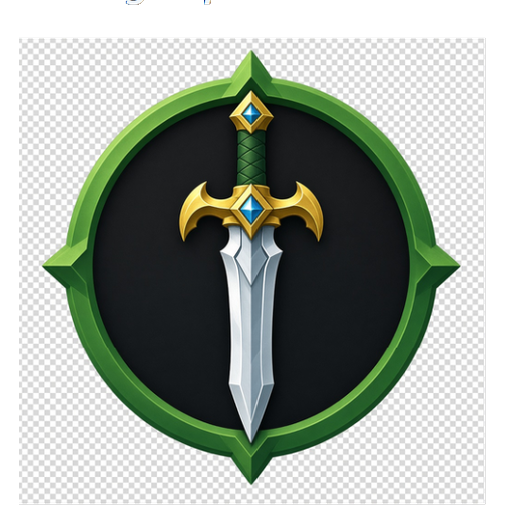
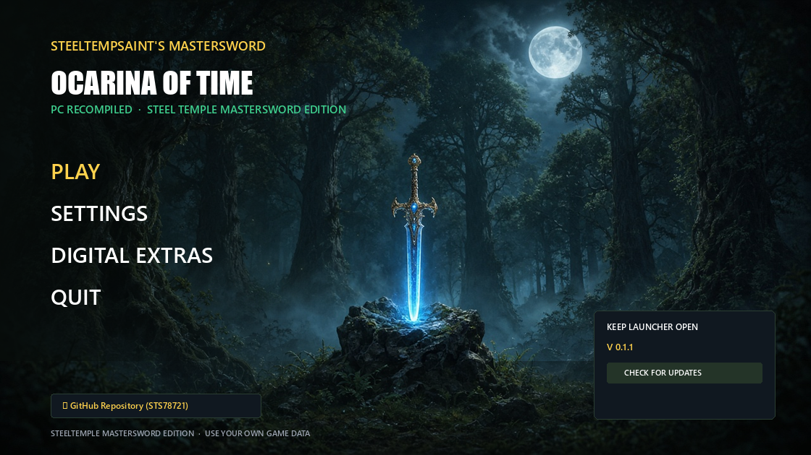

# 🗡️ SteelTempSaint's Ocarina of Time — MasterSword 🎮⚡
### *Transforming Ocarina of Time into a Flagship Modern PC Experience*

<p align="center">
  
</p>

[](https://github.com/STS78721/OOT-MASTERSWORD/releases/latest)
[](https://github.com/STS78721/OOT-MASTERSWORD/releases/latest)
[](https://github.com/STS78721/OOT-MASTERSWORD)
[](https://github.com/STS78721/OOT-MASTERSWORD)
[](https://github.com/STS78721/OOT-MASTERSWORD)
[](https://github.com/STS78721/OOT-MASTERSWORD/issues)

> [!IMPORTANT]
> **No copyrighted game files are included.** You need your own legally obtained copy of *The Legend of Zelda: Ocarina of Time* (Nintendo Switch 2 remake), dumped from your own console. No Nintendo binaries, ROMs, or cryptographic keys are distributed with this repository.

---

## 🌟 Our Vision: What We Want to Achieve

**SteelTempSaint's MasterSword** is an enthusiast-driven, high-performance static recompilation of *The Legend of Zelda: Ocarina of Time* (Nintendo Switch 2) for native Windows x86-64. There is no emulator at run time: the game's ARM64 code is translated ahead-of-time into C, Horizon OS services are reimplemented on the host, and Switch 2 NVN graphics are rebuilt on **Vulkan 1.3**.

Our goal is to **elevate *Ocarina of Time* into a native, flagship PC experience**:
- **Next-Gen Immersion:** Native PlayStation 5 DualSense support with tactile feedback and selectable controller glyph layouts.
- **State-of-the-Art Presentation:** SMAA, colour grading, multi-vendor upscaling / frame-generation menu rows, and low-latency presentation paths on modern GPUs.
- **Faithful Hyrule, Sharper on PC:** Foliage, terrain, and present-path fixes aimed at a clean Kokiri → Hyrule Field journey without the console's soft look.
- **A Completely Community-Guided Project:** The same SteelTemple Sony/Nixxes-style launcher workflow as **ToTK SteelTemple** and **DKB BANANAS** — settings outside the game, 1-click updates, save vault, and mod manager.

---

## 🎮 What Makes This Build Unique (0.1.2 Highlights)

### 🖥️ Standalone Nixxes/Sony-Style PC Launcher (`MasterSwordLauncher.exe`)
<p align="center">
  
</p>

* **PLAY / SETTINGS / DIGITAL EXTRAS** — Sony-style main menu over Master Sword key art.
* **Settings outside the game** — open SETTINGS anytime; writes `mastersword_options.ini` even before a game folder is chosen.
* **Auto update check on launch** — when a newer GitHub Release ships an Update zip, the launcher can download and install it automatically.
* **Transparent compass Master Sword icon** on the launcher EXE and package shortcuts (no white / opaque backdrop).
* **Pre-Warm Vulkan Shaders** — multi-threaded pipeline warm into the local GPU driver cache.
* **Save Backup Vault & Mod Manager** — timestamped save snapshots and simple RomFS overlay toggles.

### 🌿 Foliage, Field & Presentation
* Register-marker fix for bright red/green foliage stems.
* Sword-swing foliage vanish fix (storage-pointer handles limited to fragment stages).
* Hyrule Field distant ground lines — BC3 / ASTC one-layer hardening.
* Neon path hardening (mesh-stage policy, SSBO stretch, handle layout).
* SMAA + colour grading in the present path; Nodix-style upscale / frame-gen menu rows.

### 🛡️ Safer Starts & VRAM
* Remade CPU textures re-upload after eviction (fewer garbled blocks on 4–8 GB GPUs).
* NVIDIA Windows returns retired memory pools by default (less long-session VRAM pile-up).
* Vulkan DLL accepts host API **v4 and v5** (fixes black window + audio when DLL was ahead of the shipping EXE).
* Drop impossible depth+integer compute seed variants that could crash RADV warm-up.
* Clear MasterSword branding on the window, options, logs, and portable packages (`mastersword.exe` / `mastersword_vk.dll`).

---

## 📥 Quick Start & Downloads

Grab the latest prebuilt packages from our **[Latest Release (0.1.2)](https://github.com/STS78721/OOT-MASTERSWORD/releases/tag/0.1.2)**:

### 🎮 1. New Players (Fresh Portable Standalone)
👉 **Download: [`SteelTemple-MasterSword-0.1.2-Portable-StandAlone.zip`](https://github.com/STS78721/OOT-MASTERSWORD/releases/download/0.1.2/SteelTemple-MasterSword-0.1.2-Portable-StandAlone.zip)**
1. Extract the archive into your chosen game folder (e.g. `C:\Games\MasterSword`).
   - *Includes `MasterSwordLauncher.exe`, `mastersword.exe`, `mastersword_vk.dll`, SDL / FFmpeg / Vulkan runtimes.*
2. Place **your own** legally dumped game data beside the build (the layout your dump uses — e.g. `image.bin` / `romfs`, or `exefs` + `romfs` as required by this tree).
3. Launch **`MasterSwordLauncher.exe`**, pick the game folder if asked, configure graphics, then hit **PLAY**.

```text
C:\Games\MasterSword\
├── MasterSwordLauncher.exe
├── mastersword.exe
├── mastersword_vk.dll
├── mastersword_options.ini   <-- created by SETTINGS / first run
├── SDL2.dll, vulkan-1.dll, …
└── <your dump files / folders>
```

### ⚡ 2. Upgrading Existing Builds (Drop-in Update)
👉 **Download: [`SteelTemple-MasterSword-0.1.2-Update.zip`](https://github.com/STS78721/OOT-MASTERSWORD/releases/download/0.1.2/SteelTemple-MasterSword-0.1.2-Update.zip)**
1. Extract and overwrite into your existing MasterSword game directory.
2. Preserves saves, `mastersword_options.ini`, and mods.
3. Or let **`MasterSwordLauncher.exe`** auto-check / auto-install when a newer Update zip is published.

### 🧰 3. Setup Wizard
👉 **Download: [`SteelTemple-MasterSword-Setup.exe`](https://github.com/STS78721/OOT-MASTERSWORD/releases/download/0.1.2/SteelTemple-MasterSword-Setup.exe)**  
Guided install into a folder you choose (still needs your own dump).

### 🖥️ 4. Launcher Only
👉 **Download: [`MasterSwordLauncher.exe`](https://github.com/STS78721/OOT-MASTERSWORD/releases/download/0.1.2/MasterSwordLauncher.exe)**  
Point it at a folder that already contains `mastersword.exe`.

---

## 🎮 In-Game Controls & Overlay Shortcuts

| Action | Typical Shortcut |
| :--- | :--- |
| **Open / Close In-Game Settings Menu** | **`F1`** / **`Esc`** (controller combo where supported) |
| **Performance Overlay** | **`F10`** |
| **Toggle Fullscreen / Windowed** | **`F11`** or **`Alt + Enter`** |

Exact pad combos follow the same SteelTemple overlay conventions as ToTK / DKB builds when DualSense / Xbox layouts are selected in SETTINGS.

---

## 🛠️ Credits & Acknowledgments

- **Upstream Hookshot / Switch 2 recompilation stack** — static recompilation architecture, Horizon OS host, and NVN → Vulkan backend contributors.
- **Eden / Eglantine shader stack** — Ampere → Maxwell lowering used by the Vulkan path.
- **SMAA (iryoku)** — morphological anti-aliasing in the present path.
- **SteelTemple Community & Testers** — logs, footage, and feedback across MasterSword, ToTK SteelTemple, and DKB BANANAS.

---

## 📜 License

See **[LICENSE](LICENSE)** in this repository. Third-party notices for bundled SDKs and shader components live under `third_party/` / project docs where applicable.

*Thank you to everyone helping build the ultimate Ocarina of Time PC experience!* 🗡️🌲✨
