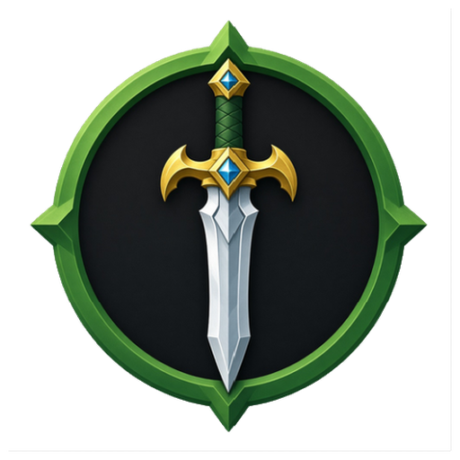
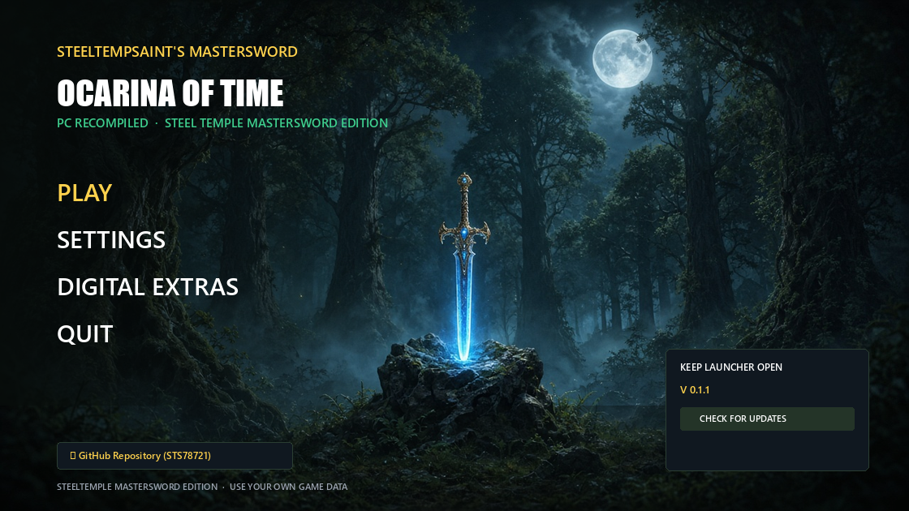

# 🗡️ SteelTempSaint's Ocarina of Time — MasterSword 🎮⚡
### *Transforming Ocarina of Time into a Flagship Modern PC Experience*

<p align="center">
  
</p>

[](https://github.com/STS78721/OOT-MASTERSWORD/releases/latest)
[](https://github.com/STS78721/OOT-MASTERSWORD/releases/latest)
[](https://github.com/STS78721/OOT-MASTERSWORD)
[](https://github.com/STS78721/OOT-MASTERSWORD)
[](https://github.com/STS78721/OOT-MASTERSWORD/releases/latest)
[](https://github.com/STS78721/OOT-MASTERSWORD/releases/latest)
[](https://github.com/STS78721/OOT-MASTERSWORD)
[](https://github.com/STS78721/OOT-MASTERSWORD/issues)

> [!IMPORTANT]
> **No copyrighted game files are included.** You need your own legally obtained copy of *The Legend of Zelda: Ocarina of Time* (Nintendo Switch 2 remake), dumped from your own console. No Nintendo binaries, ROMs, or cryptographic keys are distributed with this repository.

---

## 🌟 Our Vision

**SteelTempSaint's MasterSword** is an enthusiast-driven, high-performance static recompilation of *The Legend of Zelda: Ocarina of Time* (Nintendo Switch 2) for native Windows x86-64. There is no emulator at run time: the game's ARM64 code is translated ahead-of-time into C, Horizon OS services are reimplemented on the host, and Switch 2 NVN graphics are rebuilt on **Vulkan 1.3**.

We aim for a **native, flagship PC experience**:
- **Next-Gen Immersion** — DualSense support with tactile feedback, native mouse camera, live gameplay FOV (`50%–150%`), and selectable glyph layouts
- **Modern presentation** — **NVIDIA DLSS Super Resolution & Multi Frame Generation (2x/3x/4x/6x)**, **AMD FSR 4 & FSR 3.1 FG (2x)**, **MasterSword frame generation up to 8x**, **Nodix SMFG and Apex FG up to 6x**, Mailbox by default, SMAA, colour grading, **5K2K (`5120×2160`) ultrawide**, **NVIDIA Reflex** (active even with Frame Generation)
- **Faithful Hyrule, sharper on PC** — foliage, terrain, reactive alpha masks, true >60 FPS physics/audio/clock accuracy, shipped zero-stutter pipeline precompilation, and native-resolution CPU/AVX2/VRAM optimizations, and P-core/E-core aware threading on hybrid CPUs
- **Community workflow** — SteelTemple Sony/Nixxes-style launcher (safe 1080p out-of-the-box baseline, settings outside the game, 1-click auto-updates, save vault, mod manager)

---

## 🎮 What's in 0.2.2

<p align="center">
  
</p>

### ⚡ 0.2.2 — Fast Sync, HUD-Less FSR 3.1 FG, Job Barriers & High-FPS Gameplay Fixes
* **Fast Sync (`RX_VK_FAST_SYNC=1`) & Memory Sync Overhaul** — adds sequence-tracked CPU/GPU write-back synchronization (`msync`), tile-based partial texture updates, render-target overlap tracking, and GPU capture throttling for lower CPU sync overhead with full visual fidelity.
* **OS Job Barriers, Native Host Libc & Texture-Heap Throttling** — wakes worker barriers immediately on mask completion (`HOS_OOT_BARRIER_WAIT`), accelerates SDK `memcpy`/`memmove`/`memset`/`memcmp`/`strlen`/`strcmp` through pieced 256 KB host paths (`nx2/entry_hooks.py`), throttles texture-heap compaction to once per second (`HOS_TEX_COMPACT_MS`), and waits cleanly for in-flight save writes on window close.
* **FSR 3.1 HUD-Less Frame Generation & Hidden-Mesh Temporal Stabilization** — keeps UI/HUD text razor sharp under FSR 3.1 FG (`RX_VK_FSR_FG_HUD`), stabilizes camera-inside-Link hidden-mesh depth under temporal upscalers, replaces GPU swapchain acquire blocking with CPU acquire fences, evicts 3/4 CPU-overwritten textures cleanly, and adds hardware fixes for Intel depth bias, external host memory types, RGB-to-RGBA alpha widening, and vertex attribute divisors.
* **>60 FPS & <60 FPS Gameplay Accuracy** — fixes Epona fence jumps, Shadow Temple moving-barge carry, frozen Zora poses, 3× water ripple substeps, ocarina note advances, and Havok cloth timing.

### 🚀 From 0.2.1 (still here) — Vulkan PGO, Threaded Rendering, Selective Capture & RTX 50 Fix
* **Vulkan Renderer PGO (`mastersword_vk.dll`)** — compiled with a MasterSword-native Profile-Guided Optimization profile from live Castle Town & Hyrule Field play (`3,215` functions, `76.08B` block counts) while keeping `HOOKSHOT_SHADER_STAMP` (`0x4eae666d8f924912`) intact so existing shader/program caches never rebuild.
* **Threaded Rendering (`Auto` on 12+ logical CPUs)** — decouples Vulkan recording and present pacing via `RX_VK_PRESENTS_AHEAD` for higher, steadier frame pacing on modern multi-core CPUs.
* **Selective Submit-Time Capture (`RX_VK_CAPTURE=2`) & Shadow-Baseline Sync** — focuses submit captures on 2D/compute small buffers and readback ranges, paired with `RX_VK_SHADOW_BASELINE=1` sync, sky light accumulator resets, retired-mirror clean-page inheritance, and GPU-adaptive `p90` capture wait caps (`20 ms` baseline).
* **Native Host Zstd & Name-Search Loops** — runs `f_801102e0` zstd sequence decoding and `f_805aeea0` sorted-container name searches natively with cooperative virtual-core polling and stuck-load diagnostics.
* **Off-Thread Resource Reaper & Shared Pipeline Locks** — offloads FIFO Vulkan view/image/buffer/sparse cleanup to a dedicated reaper thread, adds shared reader-lock pipeline cache lookup (`RX_VK_PIPE_SHARED=1`), per-program pipeline ownership, direct uniform buffer snapshotting, lockless `queue_flush()` fast path, finalized GPU-drawn texture retention (`RX_VK_KEEP_DRAWN=1`), AMD 85% idle import reclamation, 512 MB managed-pagefile reserve, and Windows `ABOVE_NORMAL_PRIORITY_CLASS` (`HOS_PROCESS_PRIORITY=1`).
* **NVIDIA RTX 50 Series Water Hang & White-Link Fix** — safely skips broken half-size HDR 3D-volume box draws on RTX 50 GPUs (`RX_VK_FOG_BOXES=1` opt-out) and aligns launcher/updater checks directly to GitHub Releases.

### ⚡ From 0.2.0 (still here) — Performance, VRAM & Sync Overhaul
* **Dynamic Render Target Pool & Per-Present Target Sweep** — scales pool cap to 1/12 of VRAM (`256–768 MB`, 8-present idle trim) and sweeps overwritten transient targets every present while keeping MasterSword's 3-frame safety margin and 96 MB low-VRAM floor.
* **Character Shadow-Map Storage Bucketing (`HOS_SHADOW_BUCKET=384`)** — keeps downstream render-target addresses steady as character shadow maps resize dynamically in Castle Town.
* **Re-visited Area ASTC Texture Reuse & Flat Per-Draw Caches** — copies matching finalized ASTC textures directly on the GPU (`RX_VK_ASTC_REUSE`), removes per-draw hash/env locks, uses a 64 KB lock-free `wrote_regions` bitmap, partial vertex-buffer binds, and LRU sampler retirement.
* **AMD & Low-VRAM Stability** — `past_allowance` detects AMD's Windows driver reporting `allowed ≈ used` and reclaims textures before paging; BC decode scratch trimmed to `20–36 MB` (`1` layer default); `2 s` staging burst retention; timed-out readback & sparse-bind retry safety.
* **Sync, Audio, Movie & Icon Polish** — fixes met-wait dark lighting/Link flashes and capture/write-watch page races, enforces GPU command-order inline buffer writes/clears, bounds unbounded import scans (`import_reach`), adds 1 s virtual-core starvation boost, paces cutscenes cleanly at 240 fps during 60 fps play, fixes multi-channel DAC 5.1 mask detection, and ships clean transparent icons.

### 🔨 From 0.1.9d — Biggoron's Forge, Triforce & Sheikah Slate
* **Biggoron's Forge V1 & Capture Copy Split** — compiles the 699 busiest lifted functions from a real Castle Town profile at `-O2` with inlined float fast paths and splits per-submit memory snapshots (`~4%` Town speedup).
* **Triforce Shader Delivery, Sheikah Slate 3 & Owl Statue** — persistent SPIR-V shader pack (`mastersword_spirv.pack`), adaptive hot shader memory, per-area shader warm-ahead (`mastersword_slate.bin`), and async background saving.
* **Hardware Fixes** — accurate Scarecrow's Song and Deku Tree floor-web timing above 60 fps and version-tag ordering on update checks.

### 🚀 From 0.1.9c — Smooth play on hybrid CPUs
* **Intel Hybrid CPU Patch** (Insert / F1 menu → Graphics, **On (Recommended)** for 12th/13th/14th gen Core & Core Ultra) — the Switch 2 gives a game six identical cores. On Intel hybrid CPUs (12th gen+, Core Ultra) every game thread now runs on the **P-cores** and background work (shader builds) on the **E-cores**. On a Core Ultra 7 270K Plus frame pacing became far steadier and most graphical glitches went away.
* **Parallel replay on by default** — each frame is recorded on several threads, the count picked from your CPU's fast cores (8 P-cores → 4 threads, under 6 → off).
* **Renderer on its own P-core** — frame recording runs on a core kept free of the game's threads, then returns.
* **~1.6 GB of VRAM back** — no more mostly-empty image reserve; fewer textures cleared and reloaded at 4K.
* **Faster texture loads** — opaque textures made in their final format from the start; the 16–28 ms texture-load hitches are gone.
* **Steadier area loads** — memory upkeep waits for the new area, render targets reused under pressure, big shadow-map checks on several threads, a draw builds its own pipeline at once.
* **Fixed** — missing/torn geometry and dark lighting with parallel replay; long stalls when a draw waited for its pipeline.
* **Tip** — Windows Game Bar (Win + G → Settings → General) → **Remember this is a game**: noticeably smoother in testing. The launcher shows how on the first PLAY.
* Turn the patch off in the menu (applies after a restart); other parts in `hookshot_env.txt`: `RX_VK_PARALLEL=0`, `RX_VK_REPLAY_PIN=0`. Small hitches can still occur.

### 🏹 From 0.1.9b (still here) — Smoother area traversal
* **Area changes** — when the card is nearly full, cold textures are cleared before a large new texture is created, and texture reshuffling waits until the new area has finished streaming in.
* **Old areas** — an import that is mostly unused after a scene change is cut down to the live part. The picture in the new area is kept.
* **Smaller memory copies** — imports are 4 MB instead of 16 MB on cards that keep a video-memory mirror, so empty padding no longer counts as used memory.
* **Helpers come back** — write-back copies dropped under memory pressure are rebuilt once there is room, so one tight scene does not leave the rest of the session heavy.
* A hitch can still happen inside town. Traversal between areas is the part this update improves.
* **Mastersword Pacer (Experimental)** stays Off until you turn it on. **V-Sync Mailbox** stays the new-install default.

### 🚀 0.1.9 — Frame generation, Mastersword Pacer, Mailbox
* **Frame Generation** makes the multiplier you select. MasterSword 2x/3x/4x/6x/8x. DLSS MFG 2x/3x/4x/6x. Nodix SMFG and Apex FG (Fast) 2x–6x, including 5x. XeSS MFG 2x/3x/4x. FSR 3.1 FG is 2x.
* **Mastersword Pacer (Experimental)** is on the Graphics tab and Off by default. Turn it on to hold the game's own frames to an even beat.
* **V-Sync** is On, Mailbox, or Off. Mailbox is the default on a new install. A saved On or Off is kept.
* **Streaming upload hitch** — a one-off GPU unswizzle no longer imports a whole pool on the replay thread (Deku Tree camera turns). Same pixels.
* **Apex FG (Fast)** — recommended row; tighter motion search when that engine is on. The DLSS frame-gen model row appears only for DLSS MFG. Apex Super Resolution is not in this update.
* **Left / Right stick speed** — Controls, default 100% (stock).
* **Parallel replay** — on by default since 0.1.9c (`RX_VK_PARALLEL=0`: off).

### 🏹 From 0.1.8 (still here)
* **Hot/Cold Recompiled Code Split (`-O2`) & `.text` Call-Locality Packing** — isolates `728` hot lifted functions (`99.1%` of CPU execution) with inlined FP fast paths and orders `4,513` hot call-graph neighbours contiguously at the start of `.text`, slashing instruction-cache & iTLB misses
* **Shipped `HKSTATE2` Pipeline State List (`41,839` Pipelines)** — bundles `hookshot_pipeline_states_shipped.bin` with upgrade-aware startup pre-warming so pipelines compile ahead of time instead of stuttering in combat or new areas
* **Zero Recycled Render-Target Upload Spikes & ~10–15× Fewer Mirror-Sync Copies** — eliminates 12–17 ms `8–32 MB` CPU unswizzle spikes over finalized GPU render targets and coalesces contiguous 4 KB capture-to-mirror `VkBufferCopy` transfers
* **AVX2 Dirty-RAM `VPTEST` Scanner, Bloom-Filtered Multi-Wait Sync & Vendor-Smart Barriers** — faster write-watch page scanning, lighter kernel thread wakes, 1-in-4 GPU timestamp sampling, and tighter Vulkan render-pass/compute barriers
* **Windows 11 Hybrid P-Core / MMCSS Scheduling, RomFS Handle Cache & Live 6–8 GB VRAM Guardrail** — pins frame-critical and audio threads onto P-cores / V-Cache CCDs via MMCSS + per-thread Anti-EcoQoS, caches 64 read-only RomFS handles across room transitions, and dynamically trims idle buffer mirrors when live VRAM crosses 85%

### 🏹 From 0.1.7 (still here)
* **Live Gameplay Field of View (`50%–150%`)**, **>60 FPS moving-platform physics, 60 Hz SoundJob gating, time-of-day & movie pacing fixes**, **AMD FSR 3.1 on the shared temporal chain**, **room-transition heap retry**, and **`5120×2160` (5K2K) 21:9 ultrawide**

### 🔥 From 0.1.6 & 0.1.5c–0.1.5e (still here)
* **Real Hardware NVIDIA NGX DLSS Frame Generation (`nvngx_dlssg.dll`, 2x–4x)** + **NVIDIA Reflex**, **AMD FSR 4 & FSR 3.1 FG**, **Transparency Reactive Mask**, **Render-target image pooling (`256 MB`)**, and **1-click NGX SDK installer**

### 🖥️ Launcher (`MasterSwordLauncher.exe`)
* **PLAY / SETTINGS / DIGITAL EXTRAS** over Master Sword key art
* Automatic 1-click update check & in-place install when a newer Update zip ships
* Pre-warm Vulkan shaders, save vault, mod manager

---

## 📥 Quick Start & Downloads

Grab packages from the **[Latest Release (0.2.2)](https://github.com/STS78721/OOT-MASTERSWORD/releases/latest)**:

### 🎮 New players — Portable
👉 **[`SteelTemple-MasterSword-0.2.2-Portable-StandAlone.zip`](https://github.com/STS78721/OOT-MASTERSWORD/releases/download/0.2.2/SteelTemple-MasterSword-0.2.2-Portable-StandAlone.zip)**
1. Extract (e.g. `C:\Games\MasterSword`)
2. Put **your** dump beside it: **`image.bin` + `romfs\`**
3. Run **`MasterSwordLauncher.exe`** → SETTINGS → PLAY  
4. NVIDIA: **Download & Install DLSS SDK** in SETTINGS to install `ngx\nvngx_dlss.dll` (DLSS SR) & `ngx\nvngx_dlssg.dll` (DLSS MFG)

```text
C:\Games\MasterSword\
├── MasterSwordLauncher.exe
├── mastersword.exe
├── mastersword_vk.dll
├── hookshot_pipeline_states_shipped.bin  <-- 41,839 pre-baked pipeline states
├── amd_fidelityfx_*_vk.dll               <-- FSR 4 (AMD)
├── ngx\                                  <-- DLSS SR + DLSS-G (installed via Launcher)
├── mastersword_options.ini               <-- SETTINGS / first run (defaults to safe 1080p)
├── image.bin + romfs\                    <-- YOUR dump
└── runtime DLLs …
```

### ⚡ Existing players — Update
👉 **[`SteelTemple-MasterSword-0.2.2-Update.zip`](https://github.com/STS78721/OOT-MASTERSWORD/releases/download/0.2.2/SteelTemple-MasterSword-0.2.2-Update.zip)**  
Open **`MasterSwordLauncher.exe`** and let it download & install **`0.2.2`** automatically in 1 click — or extract the Update zip directly over your game folder.

### 🖥️ Launcher only
👉 **[`MasterSwordLauncher.exe`](https://github.com/STS78721/OOT-MASTERSWORD/releases/download/0.2.2/MasterSwordLauncher.exe)**

---

## 🎮 In-game shortcuts

| Action | Shortcut |
| :--- | :--- |
| **Insert menu** (graphics / MasterSword options) | **`Insert`** |
| **Performance overlay** | **`F10`** (where enabled) |
| **Fullscreen / windowed** | **`F11`** or **`Alt + Enter`** |

---

## 🛠️ Credits & Acknowledgments

- **NotRexed & Hookshot contributors** — static recompilation architecture, Horizon OS host, and NVN → Vulkan work this project builds on
- **Eden / Eglantine** — Ampere → Maxwell shader lowering used by the Vulkan path
- **EvilBoyce / evilmfkr (EvilOOT)** and other community GPU / foliage contributors
- **NVIDIA DLSS** — optional NGX Super Resolution & Frame Generation (downloaded by the launcher; NVIDIA trademarks)
- **AMD FidelityFX / FSR SDK** — FSR 3.1 & FSR 4 Vulkan upscaling and frame interpolation technology
- **SteelTempSaint community & testers** — logs, footage, and feedback across MasterSword, ToTK SteelTemple, and DKB BANANAS

---

## 📜 License

See **[LICENSE](LICENSE)** in this repository. Third-party notices live under `third_party/` / project docs where applicable.

*Thank you to everyone helping build the ultimate Ocarina of Time PC experience!* 🗡️🌲✨
