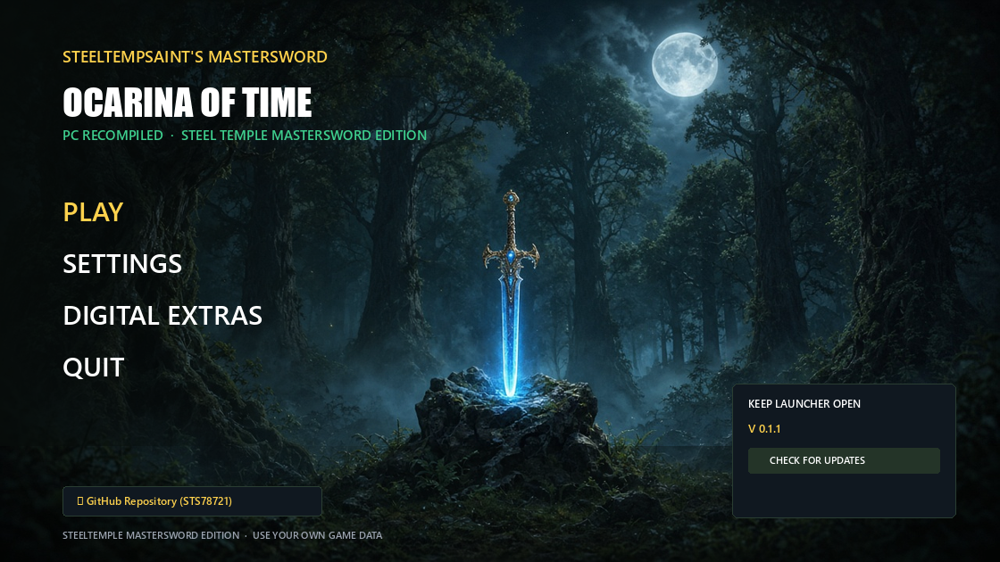

# 🗡️ SteelTempSaint's MasterSword — 0.1.0 First Release

  

Welcome to the **first public SteelTemple MasterSword** build of *The Legend of Zelda: Ocarina of Time* for PC!

This release brings the same SteelTempSaint launcher / update workflow you know from **ToTK SteelTemple** and **DKB BANANAS**, plus the foliage and presentation work from our local MasterSword tree.

> **No copyrighted game files are included.** You need your own legally obtained dump of *Ocarina of Time* (Switch). The package never ships Nintendo ROMs, keys, or game data.

---

## ⚡ What's New in 0.1.0 (Player Summary)

### 🖥️ SteelTemple Launcher & Setup
* **Sony/Nixxes-style launcher** (`MasterSwordLauncher.exe`) with PLAY / SETTINGS / DIGITAL EXTRAS
* **Settings outside the game** — open SETTINGS anytime; saves `mastersword_options.ini` even before a game folder is chosen
* **Auto update check on launch** — when a newer GitHub release has an Update zip, the launcher **downloads and installs it automatically**
* Setup wizard naming: `SteelTemple-MasterSword-Setup.exe`

### 🌿 Foliage & Visual Fixes
* Register-marker fix for bright red/green foliage stems (#759)
* Sword-swing foliage vanish fix — storage-pointer handles limited to fragment stages (#957)
* Hyrule Field distant ground lines — BC3 ASTC one layer a run (#956)
* Neon path hardening (mesh stage zero policy, SSBO stretch, handle U32x4)
* SMAA + colour grading in the present path; Nodix-style upscale/FG menu rows

### 🛡️ Safer Starts
* Drop impossible depth+integer compute seed variants (#894) that could crash RADV warm-up

---

## 📦 Downloads

| Package | What it is |
|---------|------------|
| `SteelTemple-MasterSword-0.1.0-Portable-StandAlone.zip` | Ready-to-run play folder layout (your dump still required) |
| `SteelTemple-MasterSword-0.1.0-Update.zip` | 1-click launcher auto-update payload |
| `SteelTemple-MasterSword-Setup.exe` | Setup wizard (when published) |

---

## 🙏 Credits
* SteelTempSaint community & testers
* Upstream Hookshot / Eden shader stack contributors
* SMAA (iryoku)

**Use your own game data. Play fair.**
