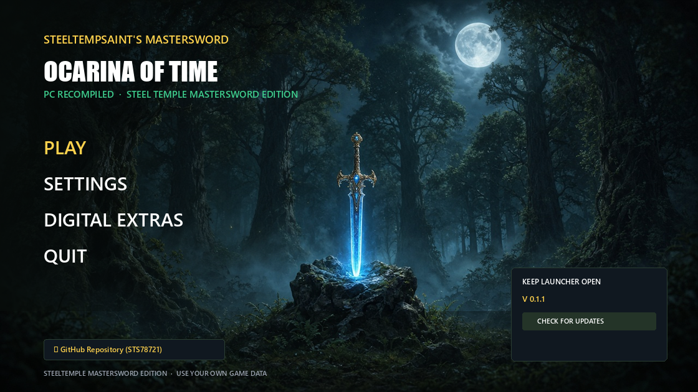

# 🗡️ SteelTempSaint's MasterSword — 0.1.1

  

A focused update for the first public **0.1.0** line: keep Vulkan working on the current host EXE, ship the foliage / presentation DLL you have been testing, and refresh branding art.

> **No copyrighted game files are included.** You need your own legally obtained dump of *Ocarina of Time* (Switch).

---

## ⚡ What's New in 0.1.1

### 🖼️ Branding & Launcher
* New **compass Master Sword** app icon (transparent) for launcher / shortcuts / packages
* GitHub / README **launcher showcase** now shows the Sony/Nixxes-style UI (PLAY / SETTINGS / DIGITAL EXTRAS), not bare key art

### 🌿 Foliage & Field (live in this DLL)
* **#759** register-marker fix — bright red/green neon stems
* **#957** fragment-only storage-pointer handles — sword-swing foliage vanish
* **#956** BC3 ASTC one-layer hardening — Hyrule Field distant ground lines
* Mesh / SSBO neon path hardening

### 🛡️ Vulkan host ABI compatibility
* DLL accepts host API **v4 and v5** and echoes the host table version
* Fixes the **black window + audio still playing** failure when a newer DLL was paired with the shipping `hookshot.exe` / `mastersword.exe`

### 🖱️ Insert menu mouse (partial)
* Upstream **#946** clickable Insert menu is in the Vulkan DLL
* Free-mouse capture needs a rebuilt host EXE (queued); keyboard / pad menu still work

### 🐧 Linux packaging
* AppImage packages `oot_cheat_items.h` (**#1012**)

---

## 📦 Downloads

| Package | What it is |
|---------|------------|
| `SteelTemple-MasterSword-0.1.1-Portable-StandAlone.zip` | Fresh play folder layout (your dump still required) |
| `SteelTemple-MasterSword-0.1.1-Update.zip` | Drop-in / launcher auto-update payload |
| `MasterSwordLauncher.exe` | Launcher only |
| `SteelTemple-MasterSword-Setup.exe` | Setup wizard |

---

## 🙏 Credits
* SteelTempSaint community & testers
* Upstream Hookshot foliage / menu / AppImage contributors (#759 #946 #956 #957 #1012 and related)
* SMAA (iryoku)

**Use your own game data. Play fair.**
