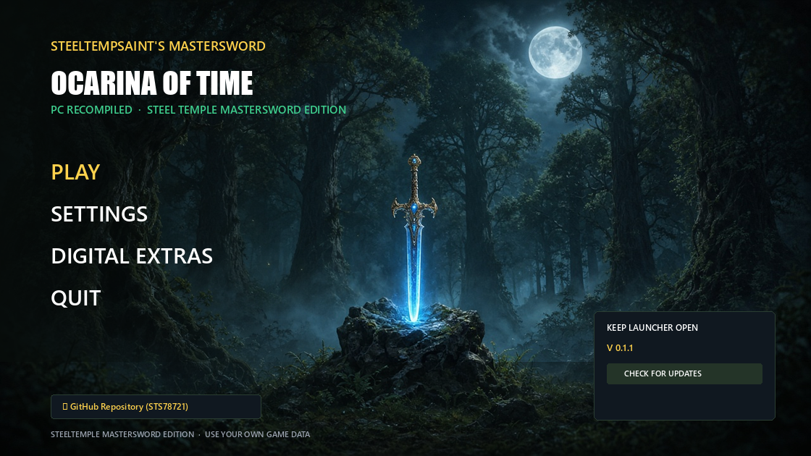

# 🗡️ SteelTempSaint's MasterSword — 0.1.2

  

Stability-focused update after upstream **v2.0.8-rc.2** review. Headless smoke on this build showed Vulkan presents before packaging.

> **No copyrighted game files are included.** You need your own legally obtained dump of *Ocarina of Time* (Switch).

---

## ⚡ What's New in 0.1.2

### 🖼️ Textures & VRAM (from upstream rc.2)
* **Remade CPU textures re-upload from memory** after eviction — fixes random-colour / garbled blocks that spread on 4–8 GB cards when menus open (issue 993; `RX_VK_REMADE_SKIP=1` restores old behaviour)
* **NVIDIA Windows:** retired memory pools are returned by default (issue 1057 VRAM pile-up / device loss after many areas; `RX_VK_KEEP_RETIRED=0/1` still overrides)

### 🧪 Debug / A-B switches (defaults unchanged)
* `RX_VK_KEEP_UNFLUSHABLE=1` — keep unflushable GPU-drawn textures
* `RX_VK_MARKERS_V205=1` — v2.0.5-style register markers (AMD stripe A/B)
* Program-cache stamp now invalidates for `RX_VK_MARKERS*` / `RX_VK_NO_INVARIANT` / `RX_VK_NO_NAN_GUARD`

### 🛡️ Still in from 0.1.1
* Vulkan host API **v4 + v5** ABI compatibility (no black window + audio)
* Foliage / field ports (#759 #956 #957)
* Transparent compass launcher / setup icon + TotK-style README showcase

### ⏭️ Not in this build yet
* Full **#939** pipeline state-list (not in our local tree)
* Host rebuild for **#946** free-mouse Insert menu
* Widescreen host caps from rc.2 (needs host EXE rebuild)

---

## 📦 Downloads

| Package | What it is |
|---------|------------|
| `SteelTemple-MasterSword-0.1.2-Portable-StandAlone.zip` | Fresh play folder layout (your dump still required) |
| `SteelTemple-MasterSword-0.1.2-Update.zip` | Drop-in / launcher auto-update payload |
| `MasterSwordLauncher.exe` | Launcher only |
| `SteelTemple-MasterSword-Setup.exe` | Setup wizard |

---

## 🙏 Credits
* SteelTempSaint community & testers
* Upstream Hookshot v2.0.8-rc.2 contributors (texture remade upload, NVIDIA retired pools, cache stamp)
* SMAA (iryoku)

**Use your own game data. Play fair.**
