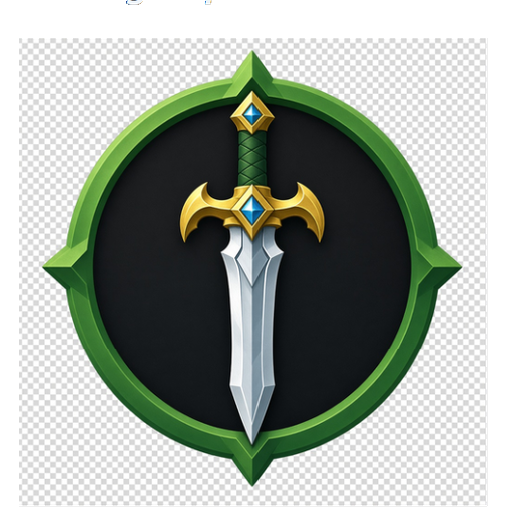

# 🗡️ SteelTempSaint's MasterSword — 0.1.5

  

<b>MasterSword branding · smoother play · DLSS still here</b>

---

## What's new

### ✨ Looks like MasterSword everywhere
Startup screen, Insert menu, launcher, and updater now say **MasterSword 0.1.5** with the SteelTempSaint logo — no more leftover Hookshot stamps.

### ❤️ HUD & textures
Hearts and HUD pieces should stop going black after you pause and come back. Texture memory is smarter about when it squeezes.

### 🌲 Kokiri & busy scenes
Replay reads a bit more at once — Kokiri and similar spots should feel smoother on many PCs.

### 💡 AMD lighting
Dark / weird lighting on some AMD cards is improved (64-lane warp handling).

### 🧩 Geometry fallback
Mesh fallback can keep far more draws on screen — fewer missing pieces on cards that need the fallback path.

### 📁 Long game folders
Install paths with long names or non-ASCII characters are handled more reliably.

### 🚀 Still in from 0.1.4
**NVIDIA DLSS Super Resolution** (presets K / M / L), **Nodix DLSS MFG** frame gen, **Reflex**, and launcher ↔ Insert menu settings sync.

---

## Download

| File | Who it's for |
|---|---|
| **`SteelTemple-MasterSword-0.1.5-Update.zip`** | Already on 0.1.4 / 0.1.3 — **overwrite** (or let the launcher auto-update) |
| `SteelTemple-MasterSword-0.1.5-Portable-StandAlone.zip` | Fresh install |
| `MasterSwordLauncher.exe` | Launcher-only refresh |

### Easy path (recommended)
1. Close the game  
2. Open **MasterSwordLauncher** → it checks GitHub and can install **0.1.5** for you  
3. If DLSS DLLs are missing: **SETTINGS → Download & Install DLSS SDK**  
4. **PLAY** — warmer / Insert menu should read **MasterSword 0.1.5**

### Manual path
1. Close game + launcher  
2. Unpack the **Update** zip over your game folder  
3. PLAY  

Restart after changing Output resolution.

---

## Thanks

- **SteelTempSaint community & testers** — logs, clips, and patience  
- **Hookshot / Eden contributors** — the recompilation & shader foundations this build stands on  
- Everyone who reported HUD, AMD lighting, and path issues  

*Your dump stays on your PC. Have fun in Hyrule.* 🗡️🌲✨
